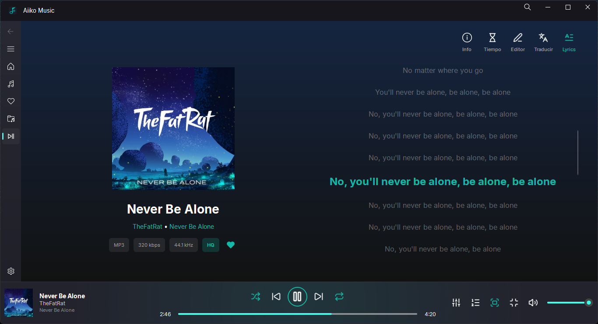
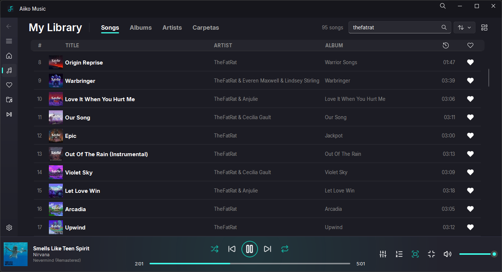
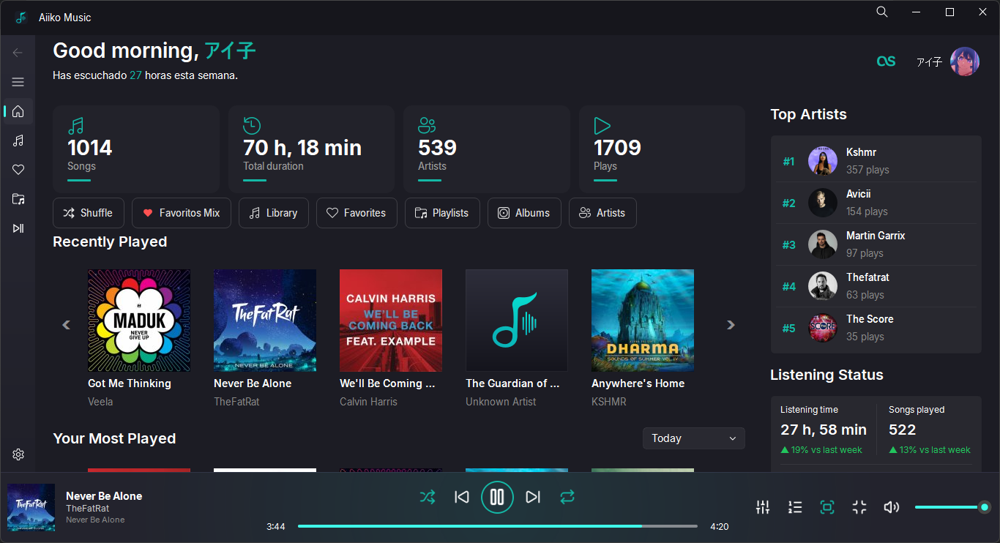
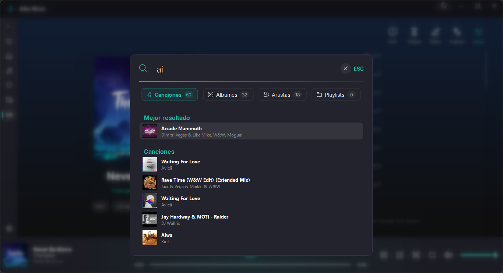
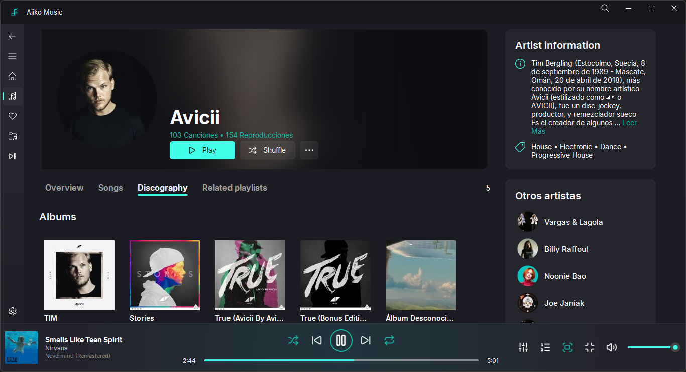
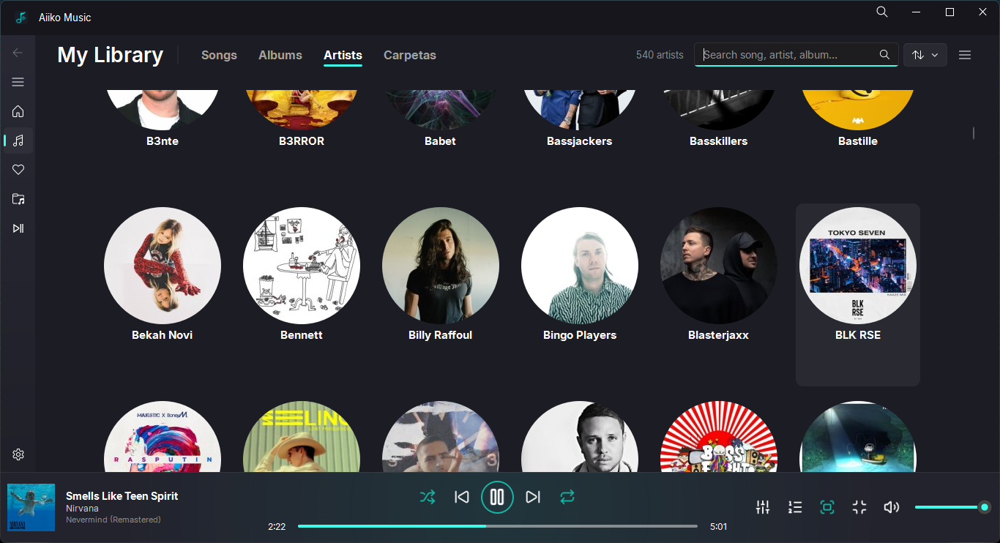
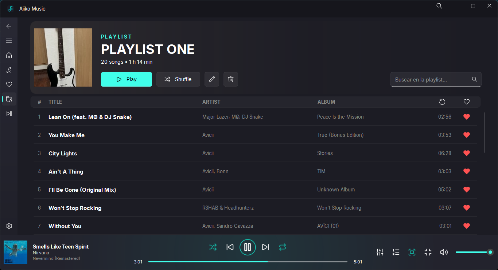
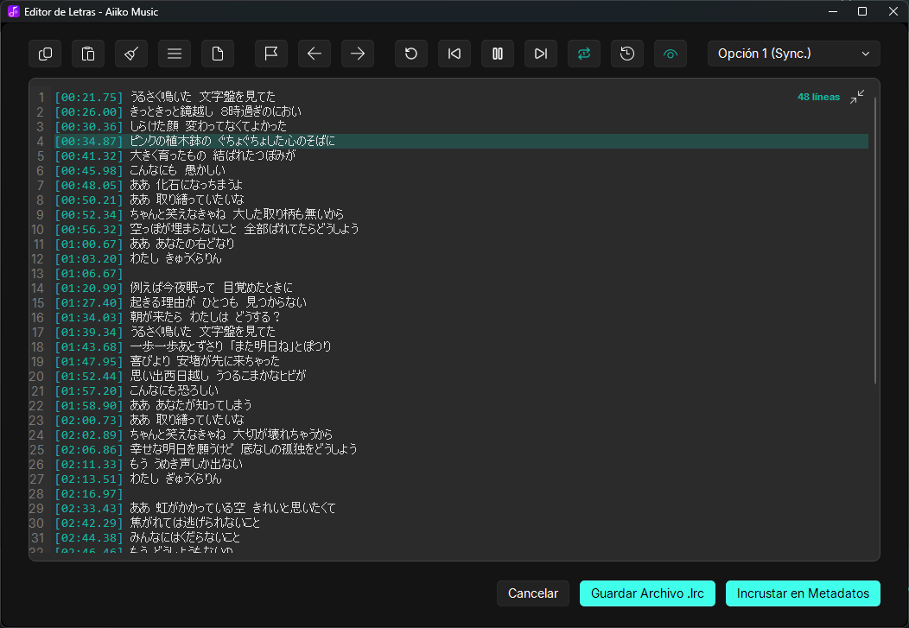
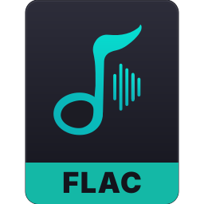
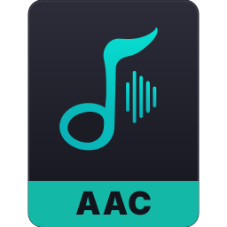

<p align="center">
  
</p>

<h1 align="center">Aiiko Music</h1>

<p align="center">
  <strong>A desktop music player for your own music library.</strong>
</p>

<p align="center">
  <a href="https://github.com/HirayamaAiiko/Aiiko-Music/releases"></a>
  
  <a href="LICENSE"></a>
</p>

<p align="center">
  Aiiko Music is a local music player for Windows, designed around personal music collections. It brings playback, albums, artists, playlists, lyrics, and metadata together in one place.
</p>

---

## Features

### Audio & Playback
- **10-band equalizer** with custom tuning
- **Gapless playback** for uninterrupted listening
- **Queue and shuffle playback** modes
- **Audio visualizer**

### Library & Organization
- **Local music library** management
- **Album and artist browsing**
- **Playlist management**
- **Library-wide search** to find tracks instantly

### Lyrics & Metadata
- **Lyrics support**, including local `.lrc` files and an integrated online finder
- **Advanced lyrics editor** with synchronization tools
- **Metadata editor** for tagging your collection
- **Album artwork** display and handling

### Experience & Customization
- **Floating mini player**
- **Fullscreen viewer**
- **Appearance & accent customization**
- **Discord Rich Presence**
- **Last.fm scrobbling**
- **Keyboard shortcuts**

---

## Screenshots

<p align="center">
  
  
</p>

<p align="center">
  
  
</p>

<p align="center">
  
  
</p>

### Lyrics Editor

Advanced lyrics editor and search tool with fine-tuned line timing:

<p align="center">
  
</p>

---

## Supported Audio

Aiiko Music supports common audio formats through its playback engine:

<p align="center">
  &nbsp;&nbsp;&nbsp;&nbsp;
  &nbsp;&nbsp;&nbsp;&nbsp;
  &nbsp;&nbsp;&nbsp;&nbsp;
  &nbsp;&nbsp;&nbsp;&nbsp;
  &nbsp;&nbsp;&nbsp;&nbsp;
  &nbsp;&nbsp;&nbsp;&nbsp;
  
</p>

> *Format support may depend on the capabilities of the playback engine.*

---

## Built With

Aiiko Music is built with Python and Qt, leveraging modern libraries for playback, UI, and audio processing:

- [PyQt6](https://www.riverbankcomputing.com/software/pyqt/) — Core application framework
- [PyQt-Fluent-Widgets](https://github.com/zhiyiYo/PyQt-Fluent-Widgets) — Fluent Design UI components
- [PyQt-Frameless-Window](https://github.com/zhiyiYo/PyQt-Frameless-Window) — Modern frameless window management
- [BASS](https://www.un4seen.com/bass.html) — Low-latency audio playback engine
- [Mutagen](https://mutagen.readthedocs.io/) — Audio metadata and tagging
- [pyqtgraph](https://www.pyqtgraph.org/) — Real-time audio visualization
- [Pillow](https://python-pillow.org/) — Image processing and album artwork

For a full list of dependencies, see [`requirements.txt`](requirements.txt). Third-party libraries and components are maintained by their respective authors and are subject to their own licenses.

---

## Installation & Download (Windows 10 & 11)

### Option 1: Standalone Release (Recommended)

The easiest way to use Aiiko Music is to download the latest executable release:

👉 **[Download Aiiko Music](https://github.com/HirayamaAiiko/Aiiko-Music/releases)**

1. Extract the downloaded `.zip` file to a folder.
2. Launch the `.exe` and follow the on-screen setup prompts displayed on first run.

### Option 2: Running from Source

To run the project directly from source:

```bash
# Clone the repository
git clone https://github.com/HirayamaAiiko/Aiiko-Music.git
cd Aiiko-Music

# Install required dependencies
pip install -r requirements.txt

# Run the application
python app/main.py
